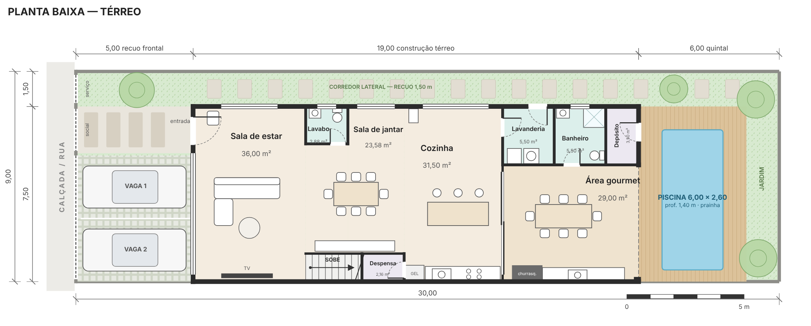
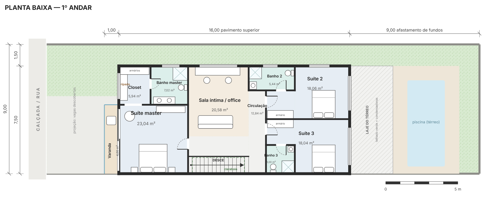
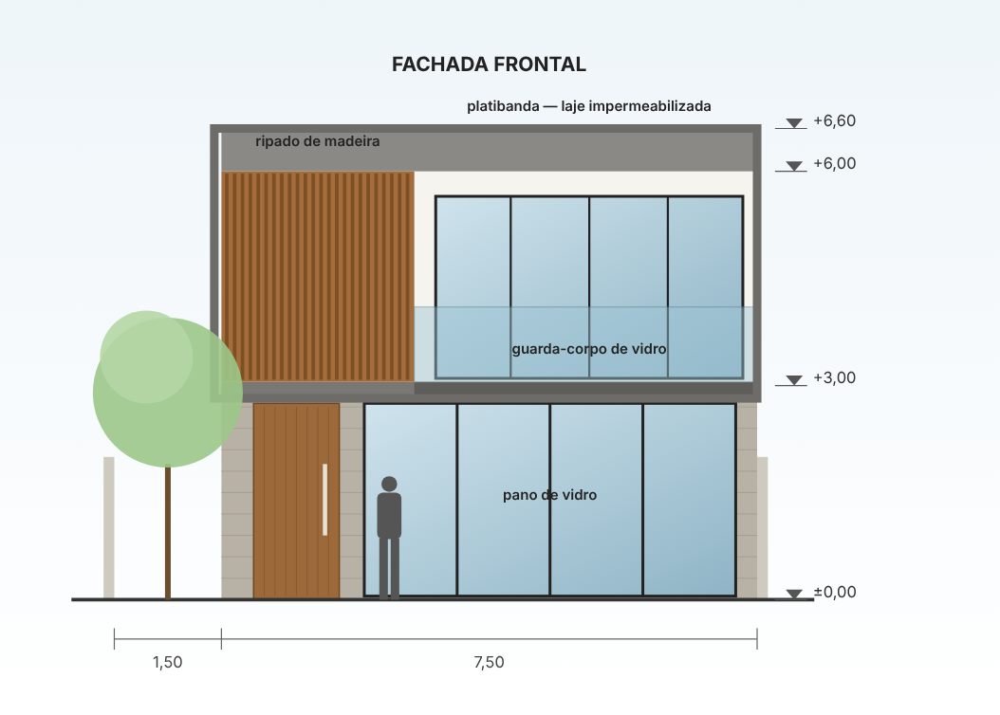
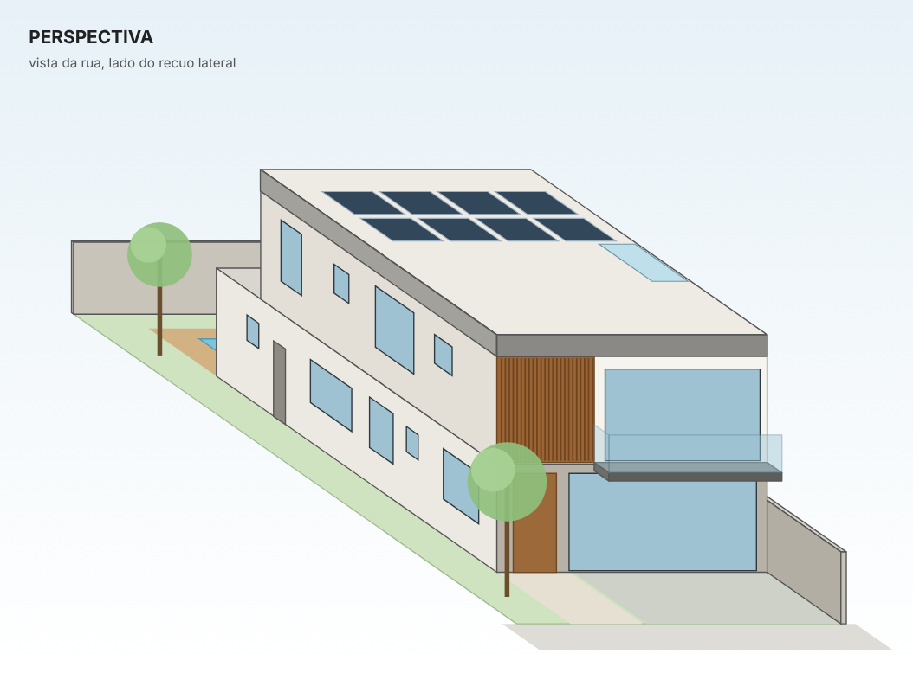

# Casa Moderna 9×30: sobrado com 1º andar

Estudo preliminar (anteprojeto) de uma casa moderna para um **lote de 9 × 30 m (270 m²)**.

**Abrir:** baixe `index.html` e abra no navegador. A página traz as plantas, a fachada, a perspectiva, o quadro de áreas, o memorial descritivo e uma calculadora de custo.

| Térreo | 1º andar |
|---|---|
|  |  |

| Fachada frontal | Perspectiva |
|---|---|
|  |  |

## Programa

**Térreo (142,50 m²)**: sala de estar (36 m²), sala de jantar (23,6 m²), cozinha com ilha (31,5 m²), lavabo, despensa sob a escada, lavanderia, área gourmet com churrasqueira (29 m²), banheiro de apoio à piscina e depósito.

**1º andar (124,80 m²)**: suíte master com closet, banho e varanda em balanço (23 m² de quarto); sala íntima / home office (20,6 m²); duas suítes nos fundos (18 m² cada, com banheiro).

**Área externa**: 2 vagas descobertas com piso drenante no recuo frontal, corredor lateral gramado, piscina de 6,00 × 2,60 m com deck e jardim no fundo.

## Números

| Item | Valor |
|---|---|
| Área construída total | 267,30 m² |
| Taxa de ocupação | 52,8% |
| Coeficiente de aproveitamento | 0,97 |
| Área permeável | ≈ 60 m² (22%) |
| Recuos | frontal 5,00 m · lateral esquerdo 1,50 m · lateral direito 0 (divisa sem aberturas) · fundos 6,00 m (térreo) / 9,00 m (1º andar) |
| Pé-direito | 2,70 m (piso a piso 2,88 m) |
| Escada | reta, 1,20 m de largura, 16 degraus (espelho 18 cm, piso 28 cm) |
| Altura total | 6,60 m até o topo da platibanda |

## Partido

- A casa encosta na divisa direita (parede cega) e deixa 1,50 m livres à esquerda. Assim, todos os ambientes desse lado têm janela, respeitando o art. 1.301 do Código Civil.
- Uma claraboia sobre a escada leva luz ao centro da casa e ajuda a ventilação (efeito chaminé). O banho 3, que fica na divisa, recebe luz zenital e tem exaustor.
- O social é integrado e se abre por uma porta de correr de 4 folhas para a área gourmet e a piscina.
- Na fachada, o térreo é revestido em pedra e o 1º andar é uma caixa branca emoldurada em concreto aparente, com ripado de madeira e panos de vidro.
- Sustentabilidade: placas fotovoltaicas, cisterna para água de chuva, telhado verde sobre a área gourmet e piso drenante nas vagas.

## Editar

Os desenhos são gerados a partir das listas de ambientes, paredes e aberturas em `gerar_projeto.py`. O texto da página fica em `modelo.html`. Depois de editar, rode:

```bash
python3 projeto-casa-9x30/gerar_projeto.py
```

## Aviso

Este é um estudo preliminar para orientar a ideia da casa. Para construir, contrate um arquiteto (RRT/CAU) ou engenheiro (ART/CREA) para o projeto legal e o executivo: topografia, sondagem, estrutura, instalações e aprovação na prefeitura. Os recuos, a taxa de ocupação e a permeabilidade variam de município para município.
